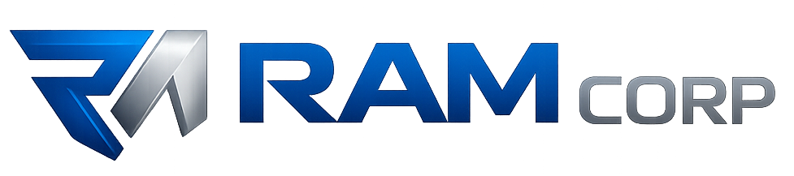

# 🧭 ExoTraza


## 📋 Descripción del proyecto

Es una plataforma empresarial orientada a gestionar la trazabilidad de operaciones, organizar información de procesos y facilitar el seguimiento de actividades desde un entorno digital centralizado.

Integra herramientas para consultar registros, identificar el estado de los procesos y disponer de información organizada que apoye la supervisión operativa y la toma de decisiones.

**Objetivos del proyecto:**
- Centralizar la trazabilidad y el seguimiento de procesos.
- Facilitar el registro y la consulta de información operativa.
- Mejorar la visibilidad de actividades, estados y resultados.
- Apoyar el control y la organización de operaciones empresariales.

## 🔍 Características clave

- 🧭 **Trazabilidad:** seguimiento estructurado de operaciones y actividades.
- 📋 **Gestión de procesos:** organización de información asociada a cada operación.
- 🔎 **Consultas:** acceso a registros y datos para su revisión.
- 📊 **Seguimiento operativo:** visualización del avance y estado de procesos.
- 🗂️ **Organización:** presentación centralizada de información.
- 🖥️ **Experiencia web:** interfaz orientada a facilitar la consulta y el control.

## 🛠 Stack tecnológico

**Frontend y experiencia de usuario**


**Backend y servicios**


**Persistencia e infraestructura**


**Seguridad y pruebas**


**Plataformas**


## 🖥️ Estructura del proyecto

```text
ExoTraza/
├── .github/
│   └── assets/
│       └── RAM-Corp.png
├── frontend/
│   ├── src/
│   │   ├── components/
│   │   ├── pages/
│   │   ├── services/
│   │   └── styles/
│   └── public/
├── backend/
│   ├── api/
│   ├── models/
│   ├── services/
│   └── tests/
└── docs/
```

## 🛡️ Derechos de autor y uso

© 2026 **RAM Corp · Julián Alberto Ramírez**.  
Todos los derechos reservados.

**Condiciones de uso:**
- Licencia privada.
- Prohibida la reproducción, distribución o explotación comercial sin autorización expresa.
- Los derechos de terceros sobre tecnologías y dependencias permanecen con sus respectivos titulares.

## 📬 Contacto corporativo

<p align="left">
  
</p>

Ecosistema tecnológico enfocado en ingeniería de software, inteligencia artificial, automatización, infraestructura digital, innovación y desarrollo de productos tecnológicos.


## **Julian Alberto Ramirez**  
🎓 Ingeniero de Sistemas  
💻 Desarrollador Full Stack Senior y ABAP Developer  
🚀 Desarrollo de software, automatización e innovación

📧 [e-mail](mailto:juliram81@hotmail.com)  
🔗 [LinkedIn](https://linkedin.com/in/julianramirezc)  
🌐 [Portafolio](https://jramirez.womosolucions.com/)

---

## 💡 Notas técnicas

Este proyecto está orientado a:

✅ Centralizar la trazabilidad de procesos empresariales.  
✅ Facilitar la consulta y organización de información.  
✅ Dar visibilidad a los estados operativos.  
✅ Apoyar el seguimiento de actividades.

**Trazabilidad para gestionar procesos con mayor claridad.**

---

## 📅 Control de versiones

  
